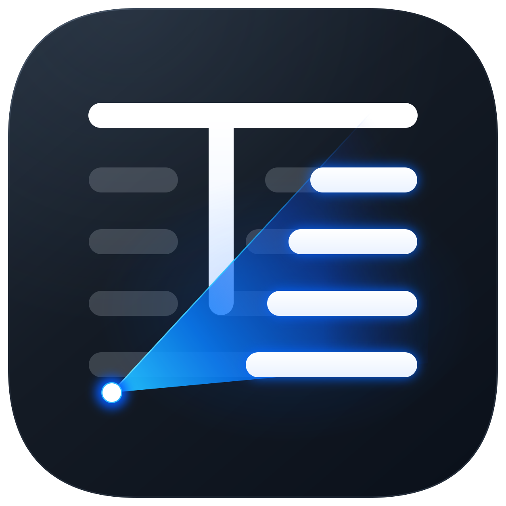
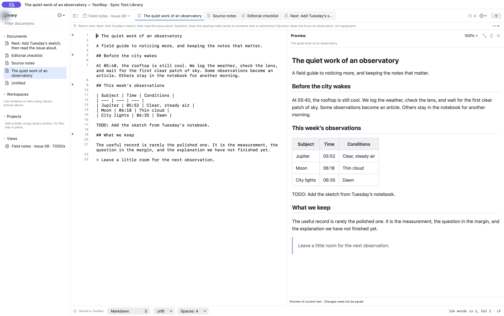
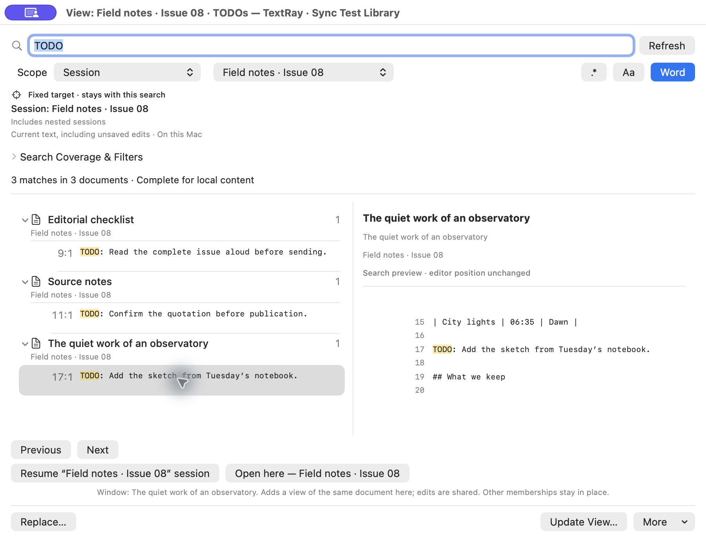

# TextRay

### Work faster with text.

A native Mac text editor that cuts the effort of saving, organizing and finding your work. Start typing without choosing a filename. Search across saved files and unsaved drafts. Put a session aside and return with your text, windows and editing position ready.

**Your work moves forward. The housekeeping stays out of the way.**

[How it works](docs/PRODUCT_WALKTHROUGH.md) · [Architecture](docs/ARCHITECTURE_OVERVIEW.md) · [Technology](docs/TECH_STACK.md) · [Engineering evidence](docs/QUALIFICATION.md)

*Real app, fictional publication. This capture is from the pre-release 0.2 (26) build; the test-library label is intentional.*

## Fewer steps around the work

| When you want to… | TextRay helps you… |
| --- | --- |
| Start immediately | Open a window or tab and type. Drafts are retained automatically, without a filename decision. |
| Find the right detail | Search a document, session, workspace, folder project or retained library. Unsaved edits participate. |
| Keep a question in sight | Save a live View for a trace ID, TODO marker or exact phrase. Its results follow relevant edits. |
| Switch contexts | Resume named or automatic sessions. Arrange free windows and link windows or tabs in overlapping workspaces. |
| Revise confidently | Name a checkpoint, inspect differences, and restore earlier text as a separate copy. |
| Finish the text | Use multi-caret editing, folds, snippets, reusable commands, heading navigation and live Markdown preview. Save ordinary files when ready. |

## One editor, several kinds of work

- **Investigations:** keep logs, commands and evolving hypotheses together, then clear your tabs without discarding the evidence.
- **Writing and publishing:** assemble sources, track editorial TODOs, preview Markdown and make precise terminology changes.
- **Projects and meetings:** start a session with useful templates, pin a return note, and resume the right arrangement later.

These are workflows built from the same documents, sessions, workspaces and Views. You can mix them or start with an empty tab.

## Search that keeps up with the text

Views store a query and its scope, not another copy of your documents. Fixed targets stay attached to the chosen session, workspace or project; following scopes visibly track the current context. The matcher is deterministic, with literal and regular-expression search, case and whole-word controls, and explicit optional normalization or typo tolerance.

[Search design and tradeoffs](docs/SEARCH_DESIGN.md)

## Built to keep work recoverable

Documents and organization live in a transactional local library. Inactive tabs keep metadata instead of requiring every document buffer to stay resident. Optional iCloud sync exchanges records and content through your private CloudKit database. Local editing remains available offline.

[Storage, memory and recovery](docs/ARCHITECTURE_OVERVIEW.md) · [Privacy and data boundaries](docs/PRIVACY_AND_LOCAL_FIRST.md)

## Getting TextRay

Download TextRay 1.0, watch real workflows and start the full 30-day trial at the [official TextRay website](https://textray.burritoslabs.com/). No card or account is required to start the trial. The website is the canonical download and purchase destination. During the initial rollout, the trial is available while checkout remains closed for final production payment and email-delivery checks.

The planned offer is **€39.99 including applicable taxes, once for TextRay 1.x on two personal Macs**. A **full 30-day trial** starts explicitly in the app, with no card or account required. Released 1.x updates are included; future major upgrades are optional. There is no subscription or separate TextRay charge for iCloud sync or Views.

At trial expiry, retained text remains accessible for reading, copying, saving, exporting and recovery. Trial expiry does not delete your work.

The current candidate has been qualified on Apple silicon with macOS 26.6.2. Other systems are not advertised as qualified solely because the app compiles for them. See [distribution and compatibility](docs/PACKAGING_AND_DISTRIBUTION.md).

## About this repository

This is TextRay’s public product and engineering reference from [Burrito’s Labs](https://burritoslabs.com/). It contains documentation, artwork and neutral screenshots. Application source, development history and binaries are not included. Official downloads will come from the website.

[Support](SUPPORT.md) · [Security reports](SECURITY.md) · [Release direction](docs/ROADMAP.md) · [Notice](NOTICE.md)
