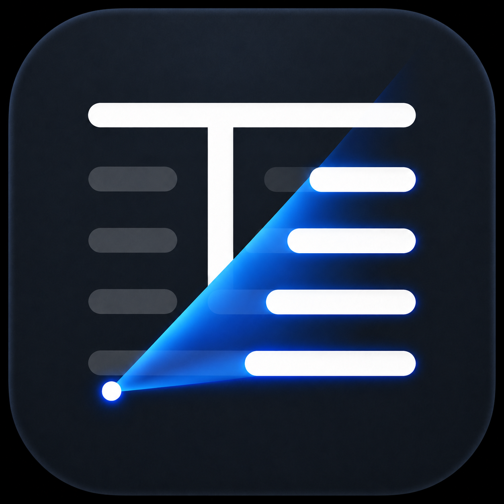
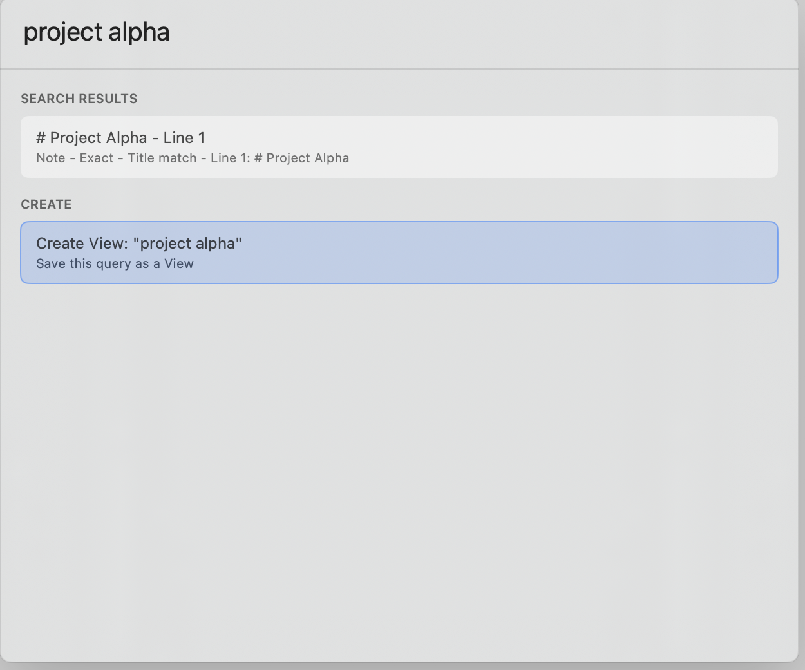
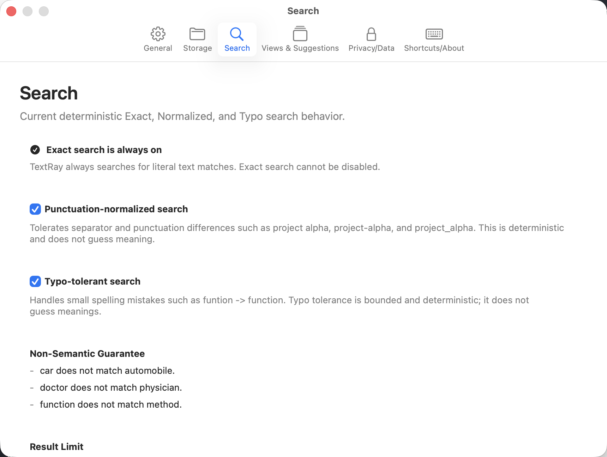
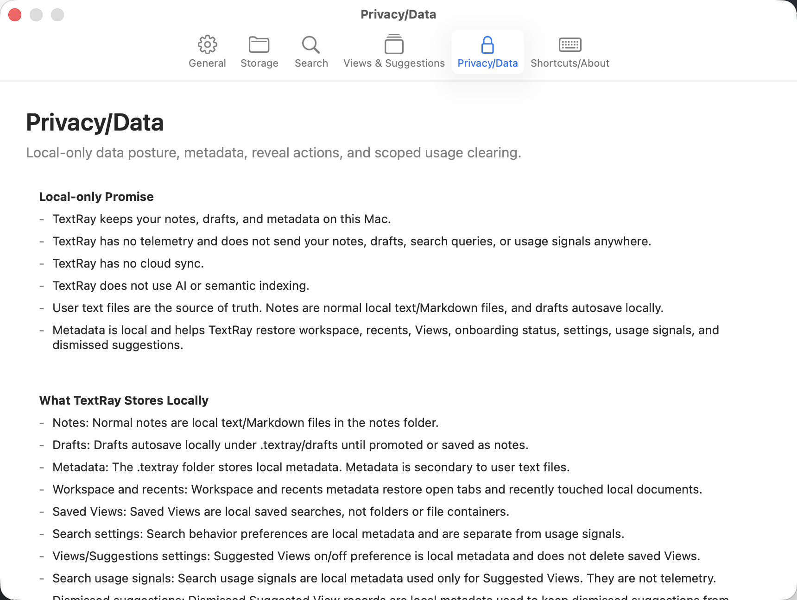
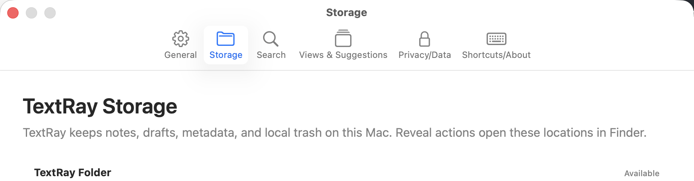
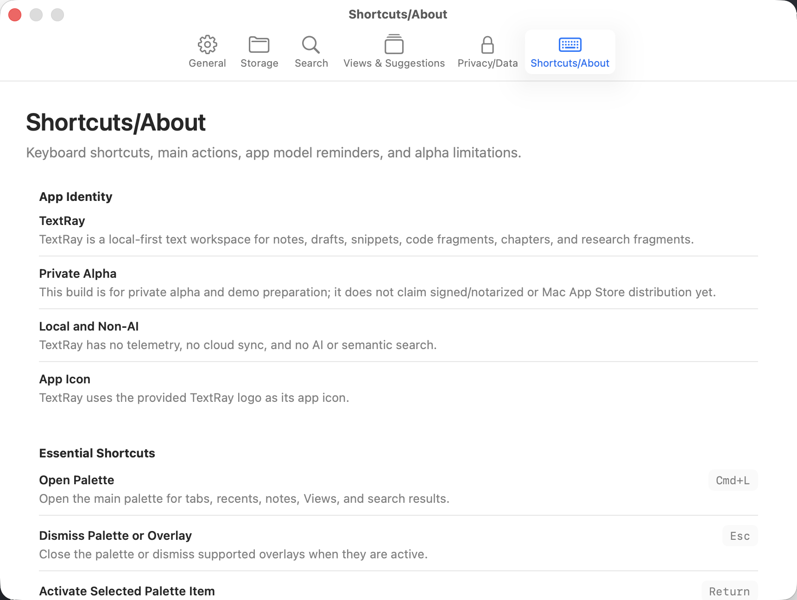
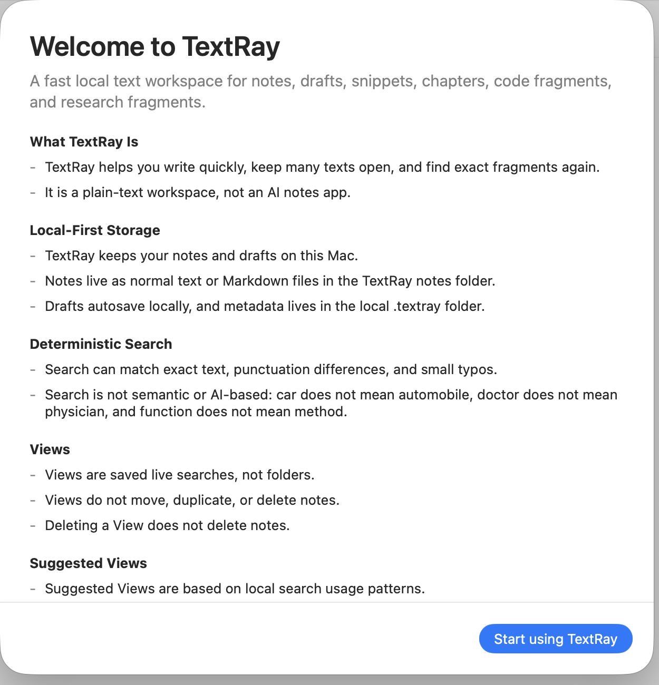
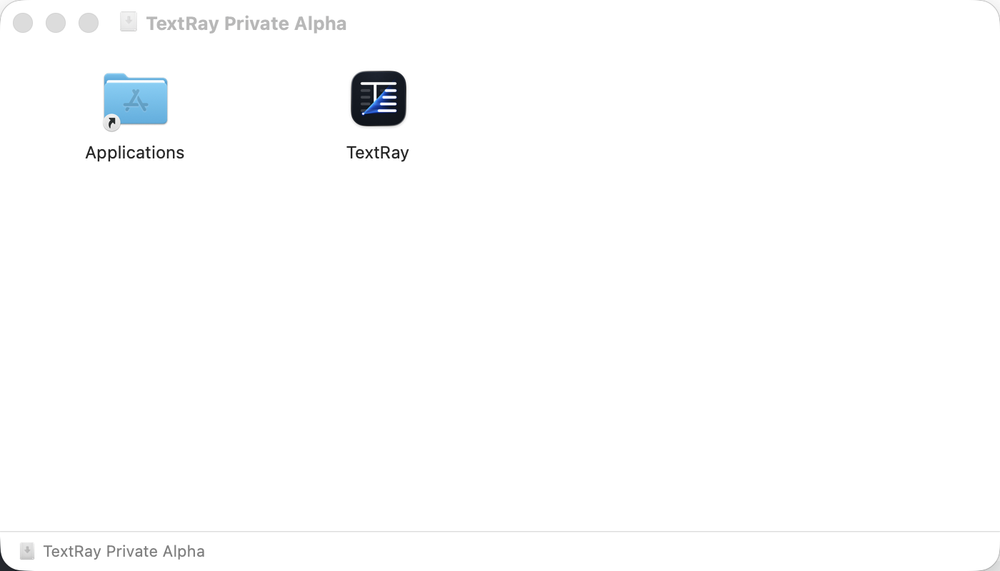

<p align="center">
  
</p>

# TextRay — Local-First Text Workspace for macOS

Write anything. Keep it open. Find it instantly. Organize naturally through live Views.


## Public Mirror Notice

This repository is a public portfolio mirror for TextRay. It contains documentation, screenshots, architecture notes, branding assets, and product information only. The TextRay source code is private and is not included in this repository.

This mirror is not an open-source release, does not include app binaries, and should not be treated as a public download channel.

## Product Preview

Screenshots are stored in [`screenshots/`](screenshots/). They are captured only from neutral demo content so the portfolio mirror does not expose user notes, internal development notes, local metadata, credentials, or private paths.

### Main Workspace


The editor keeps drafts and notes close to plain text, with tabs, recent context, autosave state, and note promotion actions visible in the main workspace.

### Palette Search



The palette combines keyboard navigation, search results, and View creation. This example uses neutral demo content to show literal matching for `project alpha`.

### Settings And Privacy



Search settings describe the deterministic match modes and the non-semantic guarantee.



Privacy/Data settings make the local-only, no-telemetry, no-cloud, no-AI posture explicit.



Storage settings document where TextRay keeps notes, drafts, metadata, and local trash. This public crop intentionally omits absolute local path rows.



Shortcuts/About gives the app identity, alpha status, local/non-AI reminder, and keyboard shortcut reference.

### First Run And Distribution



First-run onboarding explains what TextRay is, what stays local, and how search and Views behave.



The DMG install screenshot shows the direct-distribution install surface only. This mirror does not include the DMG, the app bundle, or any release artifact.

See [`screenshots/README.md`](screenshots/README.md) for capture status, hygiene rules, and any missing screenshot notes.

## Overview

TextRay is a macOS-first, local-first text workspace for people who write many notes, drafts, snippets, code fragments, chapters, and research fragments.

It is not an AI notes app. TextRay is designed around deterministic text workflows: local files, visible storage, fast tabs, direct editing, predictable search, and Views that behave like live saved searches instead of opaque folders or semantic categories.

The product goal is a writing workspace that stays close to plain text while still feeling like a real Mac app: onboarding, tabs, palette navigation, settings, privacy/data controls, install guidance, verified Release builds, and a DMG-first distribution path.

## Key Features

- Local notes and drafts stored as user-owned text files.
- Tabs and workspace restore for keeping many writing contexts open.
- Deterministic search over notes and drafts.
- Exact, punctuation-normalized, and typo-tolerant matching.
- No AI search, no semantic search, and no synonym inference.
- Views as saved live searches rather than folders.
- Suggested Views derived from local-only usage signals.
- First-run onboarding that explains local storage and privacy.
- Storage transparency surfaces that show where files and metadata live.
- Privacy/Data settings for local-first behavior and cleanup controls.
- Shortcuts/About help surface for quick orientation.
- DMG-first direct macOS distribution path.

## Technology Stack

- Swift.
- SwiftUI.
- macOS.
- XCTest.
- Local JSON metadata for workspace, recents, settings, Views, and usage signals.
- Plain text notes and drafts as the durable source of truth.
- Atomic file writing for local data safety.
- Deterministic search pipeline with explicit match quality.
- Performance benchmark suite for search, corpus build, palette responsiveness, workspace restore, and large files.
- Shell scripts for Release builds, packaging, signing checks, and Developer ID signing preparation.
- `hdiutil`, `codesign`, and `spctl` for DMG packaging and signing verification.

## Architecture

TextRay is organized as a local-first Mac app with clear boundaries:

- Storage: resolves the TextRay folder, creates required directories, reads/writes notes, drafts, metadata, trash, imports, and backups.
- Workspace/Tabs: models open contexts, restores tab order, active tab state, document references, and recent documents.
- Editor: coordinates plain-text editing, autosave, draft promotion, and note-safe document operations.
- Palette: exposes keyboard-first navigation over tabs, recents, notes, actions, create flows, and search results.
- Search: builds a local corpus and ranks exact, normalized, and typo-tolerant matches deterministically.
- Views/Suggested Views: stores saved searches and derives suggestions from local usage signals.
- Settings/Privacy: provides search behavior, Views suggestions, storage visibility, privacy/data controls, and help/about surfaces.
- Packaging/Distribution: builds Release artifacts, packages DMGs, checks signing state, and documents the private-alpha install path.

Read more in [`docs/ARCHITECTURE_OVERVIEW.md`](docs/ARCHITECTURE_OVERVIEW.md).

## Technical Highlights

- Local-first file model: user notes and drafts stay on disk as text files.
- Files as source of truth: metadata supports the workspace but does not replace user files.
- Atomic writes: metadata and draft/note updates are written through safe local file operations.
- Conflict-aware storage: file operations avoid overwriting existing notes and preserve working context.
- Local trash: destructive document flows move through local safety paths instead of silent deletion.
- Backup/export: private-alpha data safety flows are documented and covered by tests.
- Import existing notes folder: users can bring existing `.txt` and `.md` files into TextRay.
- Deterministic search and ranking: TextRay explains why a result matched and does not infer meaning.
- Performance instrumentation: benchmark coverage tracks search, corpus building, palette responsiveness, large files, and workspace restore.
- Privacy-first design: no telemetry, no cloud sync, no remote indexing, and no AI/semantic search.
- Developer ID signed DMG path: direct-distribution packaging and signing verification have been implemented for the private-alpha path when a local signing identity is available.

## Privacy Model

TextRay is designed for local control:

- No telemetry.
- No cloud sync.
- No AI or semantic indexing.
- Notes and drafts stay local.
- Metadata stays local.
- User files are the source of truth.
- Search usage signals are local-only and support Suggested Views.
- Packaging and public mirror artifacts do not include notes, drafts, `.textray` metadata, local trash, credentials, or signing material.

Read more in [`docs/PRIVACY_AND_LOCAL_FIRST.md`](docs/PRIVACY_AND_LOCAL_FIRST.md).

## Search Design

TextRay search is deterministic and explicit:

- Exact matching finds literal text.
- Punctuation-normalized matching treats mechanical separators consistently, so `project alpha` and `project-alpha` can match.
- Typo-tolerant matching catches small mechanical typos, such as `funtion` matching `function`.
- Semantic substitutes do not match: `car` does not mean `automobile`, `doctor` does not mean `physician`, and `function` does not mean `method`.

Read more in [`docs/SEARCH_DESIGN.md`](docs/SEARCH_DESIGN.md).

## Distribution Status

TextRay is currently private-source and in a private-alpha/direct-distribution preparation state.

- Direct DMG distribution is the current direction.
- Release builds pass in the private repository.
- DMG packaging exists for private-alpha inspection.
- Developer ID signed-app DMG verification has been implemented when an appropriate local signing identity is available.
- Notarization is not complete.
- Stapling is not complete.
- The Mac App Store is not the current target.
- Public release is not complete.
- This mirror does not include app binaries, DMGs, ZIPs, certificates, signing identities, or credentials.

Read more in [`docs/PACKAGING_AND_DISTRIBUTION.md`](docs/PACKAGING_AND_DISTRIBUTION.md).

## Roadmap

- Complete notarization and stapling for the direct-distribution path.
- Finish the private alpha release checklist.
- Polish public mirror screenshots and optional demo video.
- Harden based on private alpha feedback.
- Continue editor improvements where SwiftUI limitations require deeper AppKit integration.
- Audit possible App Store/TestFlight requirements later if that becomes a product goal.

Read more in [`docs/ROADMAP.md`](docs/ROADMAP.md).

## Repository Structure

```text
TextRay-public/
  README.md
  assets/
    TextRay-logo.png
    README.md
  docs/
    ARCHITECTURE_OVERVIEW.md
    PRIVACY_AND_LOCAL_FIRST.md
    SEARCH_DESIGN.md
    PRODUCT_WALKTHROUGH.md
    PACKAGING_AND_DISTRIBUTION.md
    ROADMAP.md
  screenshots/
    README.md
    *.png
  NOTICE.md
  PUBLIC_MIRROR_AUDIT.md
  .gitignore
```

## Portfolio Note

This mirror is intended as a technical and product showcase for TextRay: local-first product design, macOS app architecture, data safety, deterministic search, privacy controls, performance instrumentation, and direct-distribution packaging.

It intentionally excludes the private source code, build project, tests, app binaries, package artifacts, credentials, certificates, user data, and local metadata.
