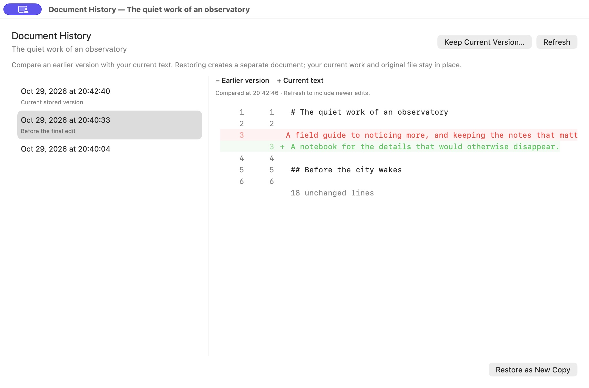

# A short working example

Start with the text. Add organization when it helps.

## Capture

Open a window or tab and type or paste a few lines. A filename is optional. TextRay derives a title from the text; for Markdown, a front-matter title or heading can provide a useful name. Document Actions lets you set a display title without changing the content or the external filename.

“Stored in TextRay” means the local recovery library has the work. “Unsaved file changes” means the chosen external original has not yet been updated. Sync status is shown separately.

## Gather an investigation, publication or meeting

Use **Start a Session** for a blank context or a small starter. Add research, code, meeting notes or drafts as needed. A session gives you a place to return to; its name is optional.

Arrange windows freely. If a useful group spans several windows or individual tabs, link them in a workspace. Workspaces can overlap. **Focus** brings that group forward; **Show All** restores access to other windows.

A project is simply a folder you register. Use it when work already lives in a directory. You do not need a project to keep scratch text.

## Keep the next question visible

Open **Search & Views** and search for a marker such as `TODO:` or a specific trace ID. Choose the named session or workspace as a fixed target, then save the query as a View. Editing an unsaved matching draft updates its results.

A following scope changes with the current context. Use a fixed target when a View should stay with one investigation or publication. The target label tells you which behavior you selected.

Search results offer an explicit destination: open in the current context or resume the document’s session. Opening the same document in another window shares its text. To branch a draft, create a separate copy instead.

## Revise and recover

Before a substantial change, use **Document Actions → Document History** to create a named checkpoint. Inspect the difference after editing. **Restore as New Copy** brings the earlier text back separately, keeping the newer draft intact.

*Real pre-release 0.2 (26) capture, using fictional text.*

Close a tab when it is out of the way. Quick Open can broaden its search to **Library, Including Closed Documents**. **Recently Closed** restores the closed arrangement and its session membership.

## Put it aside, then return

Use **Close Session** when you want to put the whole context aside. Resume it from the visible session selector. A return note can keep your next action, open question and latest decision close to the session.

Closing a single window and closing a session have different effects on the arrangement. Neither action is the same as explicitly discarding a document. Fixed Views use the selected scope’s membership, not every text item that happens to remain in Library.

## Finish when ready

For writing, use inline word counts, **Headings & Symbols**, Markdown preview, snippets and replacement preview. For code or troubleshooting, use multiple carets, folding and reusable commands. Commands keep output and diagnostics distinct, and do not silently replace newer edits made during execution.

Save a normal `.md`, `.txt`, `.py` or other text file when you want it outside TextRay. The [tutorial library](https://textray.burritoslabs.com/tutorials/) is the planned home for short real-app workflows with voiceover and switchable captions.
